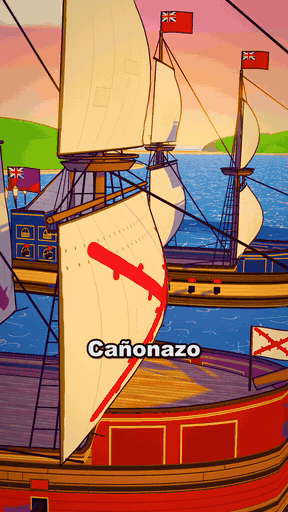

# Vídeos animados con IA

Haz tus propios cortos animados con Claude Code, en Windows o en Mac, sin saber programar.
Le cuentas una historia real, grabas tu voz con el ordenador y Claude Code hace el resto: el guion con sus fuentes,
los personajes, el mundo en 3D, la música, los subtítulos y el vídeo vertical listo para YouTube Shorts, TikTok o
Instagram. Todo es código que se ejecuta en tu ordenador: no hay ningún generador de vídeo de pago.

<p align="center">
  
  
  
  
</p>

Ejemplo incluido: «El galeón San José (1708)», 42 segundos, 11 escenas, voz grabada con la Grabadora de sonido de
Windows en una sola toma.

**Lo único que necesitas:** tu ordenador (Windows o Mac) y [Claude Code](https://claude.com/claude-code), que va con tu
plan de Claude. Todo lo demás lo instala él. Para empezar, copia la frase 1 de «Las frases» y pégasela.

**Guía completa paso a paso y ayuda si te atascas:** en el grupo gratis de WhatsApp «IA para tu Negocio»:
https://chat.whatsapp.com/Fa2MQqxJgWc6cplQSNRxl8

---

## Instrucciones para Claude Code

> Si eres una persona, sáltate esta sección: es para Claude Code. Tú solo tienes que pegarle la frase de instalación
> (más abajo, en «Las frases»).

Claude: la persona que te pide esto **no sabe programar**. Háblale en español llano y avísale en una línea de cada cosa
que vas a instalar y para qué sirve. Si lees este README desde la web, descarga primero el proyecto (paso 2) y sigue
leyendo el `README.md` desde el disco, entero.

1. **Dónde.** Busca el Escritorio real:
   - Windows: `powershell -NoProfile -Command "[Environment]::GetFolderPath('Desktop')"`. Si esa ruta está dentro de
     OneDrive, no instales ahí (OneDrive intenta sincronizar miles de archivos y da errores): instala en
     `%USERPROFILE%\videos-animados-con-ia` y crea en el Escritorio un acceso directo a esa carpeta. Explícaselo en una
     frase.
   - Mac: `~/Desktop`.
   - La carpeta se llama `videos-animados-con-ia`. Si ya existe y no está vacía, pregunta antes de tocarla.
2. **Descarga el proyecto** del enlace que te ha dado: `git clone <enlace> <carpeta>`. En Mac, si `xcode-select -p`
   falla (no hay herramientas de desarrollo, y `git` abriría una ventana para instalarlas), descarga el ZIP:
   `curl -L -o /tmp/proyecto.zip <enlace>/archive/refs/heads/main.zip`, descomprímelo y renombra la carpeta.
3. **Instala lo que falte** (comprueba primero qué hay; instala solo lo que falte; avisa antes de cada cosa):

   | Qué | Para qué sirve (díselo así) | Comprobar | Windows | Mac |
   |---|---|---|---|---|
   | Node.js LTS (20 o más) | «el motor que mueve el proyecto» | `node -v` | `winget install -e --id OpenJS.NodeJS.LTS --accept-source-agreements --accept-package-agreements` | `brew install node` |
   | ffmpeg | «la herramienta que junta imagen, voz, música y subtítulos» | `ffmpeg -version` | `winget install -e --id Gyan.FFmpeg --accept-source-agreements --accept-package-agreements` | `brew install ffmpeg` |
   | Python 3.10 o más | «para entender tu voz, hacer la música y comparar con los vídeos virales» | Windows: `py -3 --version`; Mac: `python3 --version` | `winget install -e --id Python.Python.3.12 --accept-source-agreements --accept-package-agreements` | `brew install python@3.12` |

   - **Mac sin Homebrew** (`brew` no existe): Homebrew pide la contraseña del Mac y tú no puedes escribirla. Pídele:
     «Abre la app Terminal, pega esto y pulsa Enter; cuando te pida la contraseña del Mac, escríbela (no se ve al
     escribir, es normal) y pulsa Enter:» `/bin/bash -c "$(curl -fsSL https://raw.githubusercontent.com/Homebrew/install/HEAD/install.sh)"`.
     Al terminar, Homebrew muestra 2-3 comandos «Next steps» para añadirlo al PATH: que los pegue también. Luego sigue tú.
   - **Windows, recién instalado:** la sesión actual no ve los programas nuevos. Usa sus rutas completas
     (`C:\Program Files\nodejs\`, `%LOCALAPPDATA%\Microsoft\WinGet\Links\ffmpeg.exe`,
     `%LOCALAPPDATA%\Programs\Python\Python312\python.exe`) o añádelas al PATH de tus comandos. Si escribir `python`
     abre la Microsoft Store, es un alias de Windows: usa `py -3.12` o la ruta completa.
   - En Mac, comprueba que ffmpeg sabe poner subtítulos: `ffmpeg -hide_banner -filters | grep -w ass`. Si no sale nada:
     `brew install ffmpeg-full`.
4. **Piezas del proyecto:** en la carpeta, `npm ci` («descargo las piezas del proyecto, unos minutos»). Usa siempre
   `npm ci`, nunca `npm install` ni `npm update`: las versiones están fijadas porque con las últimas el 3D sale en
   blanco en Windows.
5. **Navegador para dibujar:** en Mac, y en Windows si no hay Google Chrome instalado:
   `npx remotion browser ensure` («descargo el navegador que usa el proyecto para dibujar»). En Windows con Chrome no
   hace falta: el proyecto usa ese Chrome.
6. **Python del proyecto:** crea `.venv` en la carpeta (Windows: `py -3 -m venv .venv` o la ruta completa de
   python.exe; Mac: `python3 -m venv .venv`, o `python3.12` si lo acabas de instalar con Homebrew) e instala
   `requirements.txt` con el pip de ese `.venv` («instalo lo necesario para entender tu voz y hacer la música»).
   El modelo que entiende la voz (unos 1,6 GB) se descarga solo la primera vez que se usa.
7. **Comprueba:** `npm run diagnostico`. Arregla lo que diga antes de seguir.
8. **Acceso directo** (solo si `claude` funciona en la terminal: `where claude` en Windows, `which claude` en Mac): crea
   en el Escritorio «Abrir cortos animados» que abra Claude Code dentro de la carpeta del proyecto. Windows: un archivo
   `Abrir cortos animados.cmd` con `@echo off`, `cd /d "<carpeta>"` y `claude`. Mac: `Abrir cortos animados.command` con
   `cd "<carpeta>" && claude` y `chmod +x`.
9. **Termina:** lee el `CLAUDE.md` del proyecto y síguelo en el resto de la conversación. Dile en 3-4 líneas qué has
   instalado y dónde está la carpeta, que la próxima vez abra Claude Code con el acceso directo del Escritorio (o
   dentro de la carpeta) y que el siguiente paso es: «Enséñame el ejemplo del galeón.»

---

## Qué necesitas

Solo dos cosas: tu ordenador (Windows o Mac) y [Claude Code](https://claude.com/claude-code), que es lo único que se
paga, con tu plan de Claude. Todo lo demás (Node.js, ffmpeg, Python y las piezas del proyecto) te lo instala Claude
Code. Ocupa varios GB: deja al menos 10 GB libres.

## Las frases

Copia cada frase y pégasela a Claude Code. En la primera, cambia el enlace por el de este repositorio si no coincide.

**1. Instalarlo**

```
Crea una carpeta en mi escritorio e instálame ahí el proyecto de cortos animados desde este enlace y déjalo listo para usar: https://github.com/AlejandroGodius/videos-animados-con-ia
```

Si te pregunta algo, léelo y dile que sí. Te irá avisando de cada cosa que instala.

**2. Comprobar que funciona**

```
Enséñame el ejemplo del galeón.
```

**3. Tu historia** (cambia lo de los corchetes)

```
Hazme un corto de 45 segundos sobre [tu historia]. Que todo sea verdad y escríbeme el guion.
```

Te devuelve el guion y de dónde sale cada dato. Si algo no te encaja, díselo como a una persona: «más gracioso»,
«quita eso», «el final más corto».

**4. Tu voz.** Abre la Grabadora de sonido (en Mac, Notas de voz), dale al botón rojo y lee el guion rápido y sin
pausas, como si se lo contaras a un amigo con prisa. Si te trabas, repite la frase y sigue. Luego:

```
Ya he grabado mi voz. Ponla en el corto.
```

**5. Que lo anime**

```
Anímalo y enséñame cómo queda cada escena antes de hacer el vídeo.
```

Y le hablas como a un dibujante:

```
En la escena 3, el barco más grande y al atardecer.
```

```
En la escena 5, más humo y más movimiento.
```

```
Ese personaje, con sombrero de explorador.
```

Si algo no te gusta y no sabes decir por qué:

```
Compáralo con los cortos virales y arréglalo.
```

Mide tus escenas contra los números de 20 cortos virales del mismo estilo (brillo, contraste, color, líneas de tinta,
cielo, tamaño del personaje), te dice qué falla y lo corrige.

**6. El vídeo final**

```
Haz el vídeo final con música y subtítulos.
```

```
Limpia lo que sobra.
```

**Si algo falla**

```
No me sale.
```

## Problemas frecuentes en Windows

- **Sale en blanco.** Dile «me sale en blanco». Casi siempre es porque se han cambiado las versiones de las piezas del
  proyecto; Claude las reinstala con las buenas y lo comprueba con un cubo de prueba.
- **Tu Escritorio está en OneDrive.** Claude instala el proyecto en tu carpeta de usuario y te deja un acceso directo
  en el Escritorio, porque OneDrive intentaría sincronizar miles de archivos.
- **Acaba de instalar algo y dice que no lo encuentra.** Cierra Claude Code y vuelve a abrirlo (con el acceso directo
  «Abrir cortos animados» del Escritorio).
- **Al escribir `python` se abre la Microsoft Store.** Es un atajo de Windows; Claude usa el Python del proyecto y no
  le afecta.
- **El ordenador va a tope y los ventiladores suenan** al hacer el vídeo final. Es normal: está dibujando cientos de
  imágenes en 3D.
- **Te quedas sin espacio.** Cada vídeo deja archivos temporales. Dile «limpia lo que sobra».
- **No encuentra tu grabación.** La Grabadora de sonido guarda en `Documentos\Grabaciones de sonido` (o en OneDrive si
  tus Documentos están ahí). Si la guardaste en otro sitio, arrastra el archivo a la ventana de Claude Code.

## Probado en

Probado en Windows 11; en Mac no lo hemos podido probar, la skill original nació en Mac.

## Licencia

- El código y la documentación son MIT (ver [LICENSE](LICENSE)). Lo que no es nuestro, en [LICENCIAS-DE-TERCEROS.md](LICENCIAS-DE-TERCEROS.md).
- **Remotion**, el programa que convierte el código en vídeo, tiene su propia licencia: es gratis para particulares y
  empresas de hasta 3 personas; las empresas más grandes necesitan una licencia de empresa de Remotion. Compruébalo en
  [remotion.dev/license](https://www.remotion.dev/license).
- Modelos 3D de Kenney: CC0 (dominio público).
- La voz del ejemplo del galeón es de Godius: úsala para probar el proyecto, no en tus vídeos.

## Créditos

- Skill original: [Mr omi](https://github.com/mromidev/claude-animated-shorts) (MIT).
- Modelos 3D: [Kenney](https://kenney.nl) (CC0).

Adaptación en español y para Windows: hecho por [Godius](https://godius.io).
